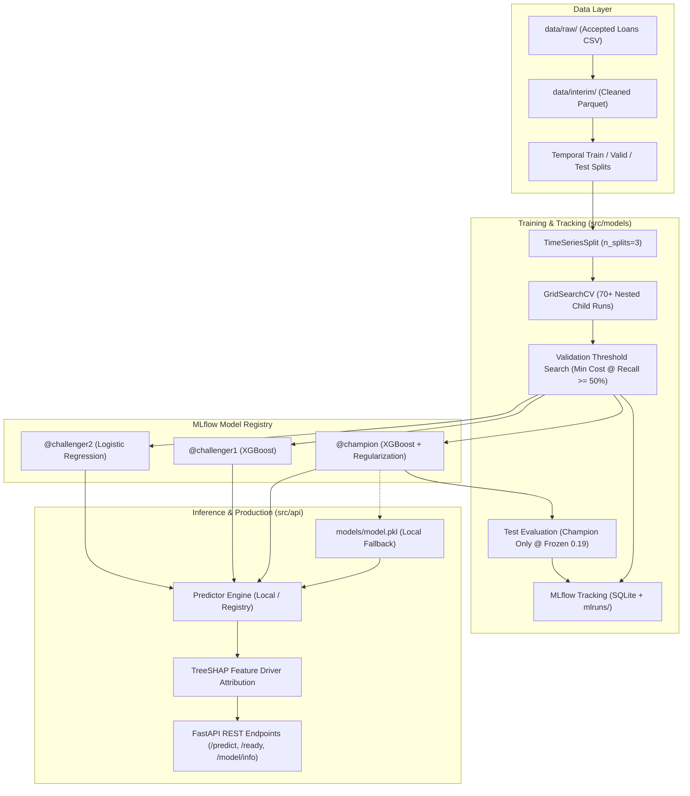

# Lending Club Loan Default Risk Prediction & MLOps Platform

[](https://www.python.org/downloads/)
[](https://fastapi.tiangolo.com)
[](https://mlflow.org/)
[](https://xgboost.readthedocs.io/)
[](https://www.docker.com/)
[](tests/)

An end-to-end, production-grade Machine Learning and MLOps system that predicts credit loan default risk using Lending Club data. 

The system implements cost-sensitive threshold optimization, rigorous chronological validation with zero data leakage, comprehensive MLflow experiment tracking with nested hyperparameter trials, an MLflow Model Registry with Champion/Challenger deployment aliases, instant model rollback capabilities, explainable predictions via TreeSHAP, and a containerized FastAPI service.

---

## 1. Business Problem & Cost-Sensitive Framework

In consumer credit lending, default prediction is an inherently imbalanced and asymmetric classification problem:
- **False Negative (FN):** An applicant predicted as safe who actually defaults. The lender loses significant unpaid principal.
- **False Positive (FP):** A safe applicant flagged as default risk and rejected. The lender forfeits interest profit and origination fees.

Missing an actual defaulter is substantially more catastrophic than rejecting a good applicant. Consequently, this system operates under a configurable **asymmetric cost ratio**:

$$\text{COST\_RATIO} = \frac{\text{Cost of FN}}{\text{Cost of FP}} = 4.0$$

### Decision Optimization Objective
Rather than optimizing for generic accuracy or default 0.5 probability cuts, decision thresholds are dynamically calibrated on the validation set to minimize **Expected Cost Per Loan** while maintaining an institutional compliance constraint of **at least 50% defaulter recall**:

$$\text{Expected Cost Per Loan} = \frac{\text{FP} + 4 \times \text{FN}}{N}$$

$$\text{Subject to:} \quad \text{Recall}_{\text{defaulters}} \ge 0.50$$

At the optimal validation threshold of **`0.19`**, the Champion model captures **54.01%** of all defaulters while delivering the lowest expected loss across all candidates.

---

## 2. System Architecture



---

## 3. Project Structure

```text
ML_Project/
├── configs/
│   └── config.yaml               # Unified MLflow, business, data, & API configuration
├── data/
│   ├── raw/                      # Raw Lending Club datasets (.gitkeep tracked)
│   ├── interim/                  # Cleaned parquet data files
│   └── processed/                # Chronologically split train/valid/test datasets
├── models/
│   ├── model.pkl                 # Serialized production pipeline (ColumnTransformer + Estimator)
│   ├── model_metadata.json       # Version, threshold, metrics, and feature metadata
│   └── .gitkeep
├── notebooks/
│   ├── 01_create_interim_parquet.ipynb # High-efficiency Parquet conversion
│   ├── 02_data_understanding.ipynb    # Column schemas and domain definitions
│   ├── 03_data_cleaning.ipynb         # Missing value strategies, leakage removal
│   ├── 04_eda.ipynb                   # Target distribution and bivariate analysis
│   ├── 05_feature_engineering.ipynb   # Transformations, encoders, and ratios
│   └── 06_model_experimentation.ipynb # Model benchmarking & cost optimization
├── src/
│   ├── api/
│   │   ├── main.py               # FastAPI application with lifecycle management
│   │   ├── predictor.py          # Dual-source inference engine (local disk & MLflow)
│   │   └── schemas.py            # Pydantic v2 validation models & request/response types
│   ├── config/
│   │   └── config.py             # Dataclass configuration loader with env overrides
│   ├── features/
│   │   └── engineering.py        # DTI, credit history, and payment-to-income feature logic
│   ├── models/
│   │   ├── evaluate.py           # Threshold sweeps, cost curves, and evaluation plots
│   │   ├── mlflow_utils.py       # MLflow client, alias registration, and instant rollback
│   │   └── train.py              # End-to-end 3-model experimentation workflow
│   └── pipeline/
│       ├── train.py              # CLI entry point to train and register models
│       └── training_pipeline.py  # Data preprocessing and transformer pipelines
├── tests/
│   ├── test_api.py               # FastAPI endpoints, readiness, and parity tests
│   ├── test_features.py          # Transformer and feature calculation unit tests
│   └── test_mlflow.py            # Tracking, alias assignment, rollback, & parity tests
├── Dockerfile                    # Multi-stage, non-root, production container image
├── .dockerignore                 # Excludes data, virtual environments, caches, and DBs
├── .gitignore                    # Comprehensive rules protecting secrets and large data
├── requirements.txt              # Production Python dependencies
└── README.md
```

---

## 4. Machine Learning & Methodology

### Zero Data Leakage Guarantee
1. **Temporal Splitting:** The data is split chronologically by loan issuance date (`issue_d`):
   - **Train:** $\le 2012$ (fit transformers and hyperparameter search)
   - **Validation:** $2013$ (model comparison and decision threshold optimization)
   - **Test:** $2014+$ (final unbiased evaluation evaluated **strictly once**)
2. **Cross-Validation:** Hyperparameter tuning uses chronological `TimeSeriesSplit(n_splits=3)` exclusively on the training set to prevent future data from leaking into past predictions.
3. **Target Leakage Removal:** Post-origination features (e.g. `recoveries`, `collection_recovery_fee`, `last_pymnt_amnt`, `total_rec_prncp`) are stripped prior to model input.

### Model Comparison & Registry Aliases

All candidate models were trained with GridSearchCV and evaluated on the held-out validation set:

| Model Candidate | Algorithm | Validation Cost Per Loan | Selected Threshold | Defaulter Recall | Defaulter Precision | Registry Alias |
|---|---|---|---|---|---|---|
| **Champion** | **XGBoost (L1/L2/Gamma Reg)** | **`0.5211`** | **`0.19`** | **`54.01%`** | **`31.01%`** | **`@champion`** |
| Challenger 1 | XGBoost (Standard) | `0.5221` | `0.20` | `51.86%` | `31.68%` | `@challenger1` |
| Challenger 2 | Logistic Regression | `0.5238` | `0.20` | `51.68%` | `31.75%` | `@challenger2` |

### Final Test Evaluation (Champion Only)
The test set was evaluated once at the frozen validation threshold of **`0.19`**:
- **Test ROC-AUC:** `0.6983`
- **Test PR-AUC:** `0.3358`
- **Test Defaulter Recall:** `54.41%`
- **Test Precision:** `29.06%`
- **Test Expected Cost Per Loan:** `0.5545`

---

## 5. MLflow Tracking & Artifact Management

The system tracks all runs inside a local persistent SQLite database (`mlflow.db`) and artifact store (`mlruns/`):

- **70+ Nested Child Runs:** Every individual hyperparameter fold and parameter combination is logged as a child run under its parent algorithm.
- **Logged Visualizations & Artifacts:**
  - `plots/roc_curve.png` & `plots/precision_recall_curve.png`
  - `plots/confusion_matrix.png` at the optimal business threshold
  - `plots/business_cost_curve.png` (Expected cost vs. threshold with approve-all benchmark)
  - `plots/precision_recall_vs_threshold.png`
  - `reports/threshold_comparison.csv` (Full evaluation across threshold grid $0.05$ to $0.95$)
  - `reports/cost_sensitivity.csv` (Cost ratio variations: $2, 3, 4, 5, 6, 8, 10$)
  - Full scikit-learn preprocessing + prediction pipeline serialized via Cloudpickle.

---

## 6. FastAPI Inference Service

The production API serves real-time loan default predictions with built-in interpretability.

### Key Endpoints

| Method | Endpoint | Description |
|---|---|---|
| `GET` | `/health` | Kubernetes / Docker liveness probe (`{"status": "ok"}`) |
| `GET` | `/ready` | Readiness probe (verifies pipeline is loaded in memory) |
| `GET` | `/model/info` | Returns active model name, version, threshold, and feature schema |
| `POST` | `/predict` | Single loan applicant prediction + top TreeSHAP risk factors |
| `POST` | `/predict/batch` | High-throughput batch prediction for applicant lists |
| `GET` | `/docs` | Interactive Swagger UI documentation |

### Sample Prediction Request & Response

```bash
curl -X POST "http://localhost:8000/predict" \
  -H "Content-Type: application/json" \
  -d '{
    "loan_amnt": 15000,
    "term": " 36 months",
    "int_rate": 14.5,
    "installment": 516.4,
    "sub_grade": "C3",
    "annual_inc": 65000,
    "dti": 18.5,
    "fico_range_low": 680,
    "fico_range_high": 684,
    "open_acc": 10,
    "pub_rec": 0,
    "revol_bal": 12000,
    "revol_util": 58.2,
    "total_acc": 22,
    "mort_acc": 1
  }'
```

```json
{
  "default_probability": 0.2845,
  "default_probability_percent": 28.45,
  "decision_threshold": 0.19,
  "flag_as_default": true,
  "recommendation": "Flag for Manual Underwriting Review / Decline",
  "shap_drivers": [
    {"feature": "int_rate", "contribution": 0.0821, "description": "Higher interest rate increases default risk"},
    {"feature": "sub_grade", "contribution": 0.0614, "description": "Lower credit subgrade increases risk"},
    {"feature": "annual_inc", "contribution": -0.0435, "description": "Higher income reduces default risk"}
  ]
}
```

---

## 7. Operations & Usage Guide

### 1. Setup Environment
```powershell
# Clone repository
git clone https://github.com/sohamkanse1718-dev/credit-risk-modeling.git
cd credit-risk-modeling

# Create and activate virtual environment
python -m venv venv
.\venv\Scripts\Activate.ps1

# Install dependencies
pip install -r requirements.txt
```

### 2. Run Complete MLflow Training Pipeline
Trains all 3 candidates, runs hyperparameter search, selects Champion on validation cost, evaluates Test set once, registers aliases, and saves the production artifact:
```powershell
python -m src.pipeline.train
```

### 3. Launch MLflow UI
```powershell
python -m mlflow ui --backend-store-uri sqlite:///mlflow.db --port 5000
```
Open [http://localhost:5000](http://localhost:5000) to inspect experiment runs, comparative cost curves, and registry aliases.

### 4. Run FastAPI Application

#### Option A: Local Model Artifact (Default)
```powershell
$env:MODEL_SOURCE = "local"
python -m uvicorn src.api.main:app --host 0.0.0.0 --port 8000 --reload
```

#### Option B: MLflow Model Registry Champion
```powershell
$env:MODEL_SOURCE = "mlflow"
$env:MLFLOW_MODEL_ALIAS = "champion"
python -m uvicorn src.api.main:app --host 0.0.0.0 --port 8000
```

#### Option C: Canary Testing with Challenger
```powershell
$env:MODEL_SOURCE = "mlflow"
$env:MLFLOW_MODEL_ALIAS = "challenger1"
python -m uvicorn src.api.main:app --host 0.0.0.0 --port 8000
```

### 5. Instant Zero-Downtime Model Rollback
If a newly deployed model exhibits anomalies, revert the champion alias instantly without redeploying code:
```python
from src.models.mlflow_utils import rollback_champion_to_version

# Revert to version 2 (or any prior stable version)
result = rollback_champion_to_version(target_version="2")
print(result)
# Output: {'status': 'success', 'current_champion': '2', 'demoted_to_challenger1': '1'}
```

### 6. Run Test Suite
```powershell
python -m pytest tests/
```

### 7. Docker Deployment
```powershell
# Build container image
docker build -t lending-club-api:latest .

# Run container
docker run -d -p 8000:8000 --name lending-risk-service lending-club-api:latest

# Check container health status
docker inspect --format='{{json .State.Health}}' lending-risk-service
```

---

## 8. Cloud Deployment (Next Target)

The upcoming roadmap focuses on transitioning the localized production pipeline into a scalable, enterprise-grade cloud architecture:

---

## 9. License & Attribution

This project is developed for educational and portfolio demonstration of production-grade Machine Learning and MLOps engineering. Data source provided by Lending Club via public loan disclosure archives.
